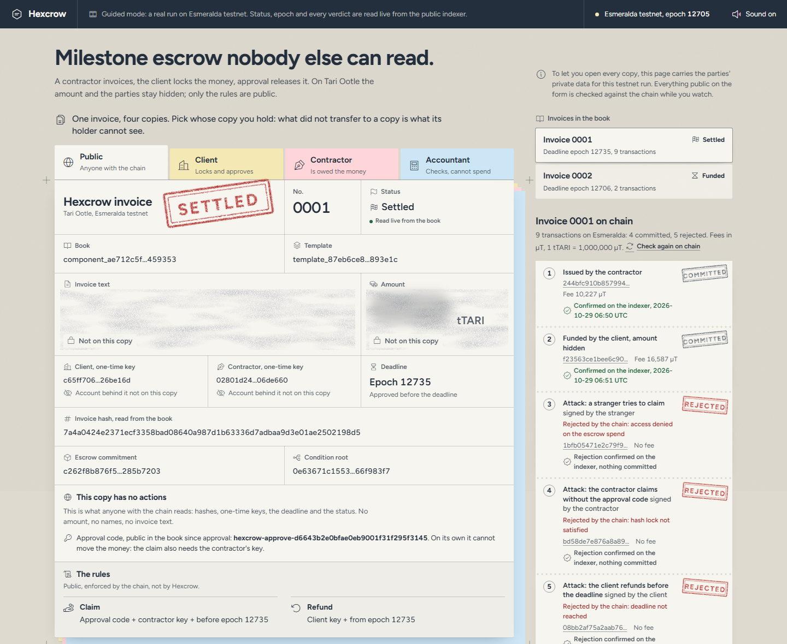
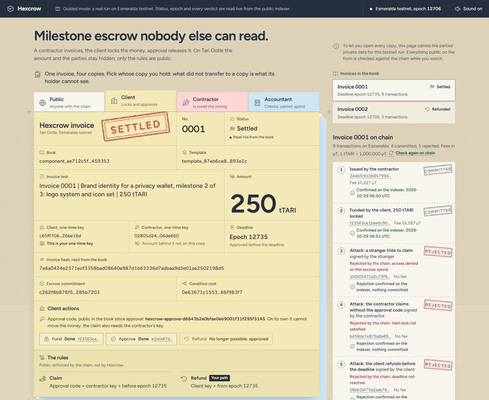

# Hexcrow

**Milestone escrow nobody else can read.** A contractor invoices, the client locks the money, approval releases it. On Tari Ootle the amount and the parties stay hidden; only the rules are public.

Built for the Tari Council October 2026 build contest, "Spooky Secrets".

- **Hosted demo:** link added on publication. No wallet, no install: it replays a real run on Esmeralda testnet and checks every public fact against the public indexer while you watch.
- **Proof:** every transaction of the run, with how to check it yourself, in [PROOF.md](PROOF.md).
- **What stays hidden and what leaks:** [THREAT_MODEL.md](THREAT_MODEL.md).



## The problem

An independent designer starts each milestone without knowing whether the client has the money. If they get paid on a transparent chain, anyone can see what they charge, who they bill and how much they earn each month. The company paying them has the opposite worry: it wants to release money only on approval, and get it back if the work never arrives.

A member of the Tari Council asked for this on the forum on 25 October: confidential invoicing, private payments to contractors, milestone escrow for commercial work, and selective disclosure to authorised parties ([Field Notes for Ootle Builders](https://community.tari.com/t/486)).

## How it works

One invoice, four copies. Like a carbon-copy invoice pad, each viewer holds a different copy, and what did not transfer to a copy is what its holder cannot see.

| Viewer | Sees |
|---|---|
| Public (anyone with the chain) | Invoice hash, deadline epoch, status, escrow commitment and condition root, one-time keys, transaction ids. No amount, no names, no invoice text |
| Client | The above, plus the amount, the invoice text and the approval code it holds |
| Contractor | The above, plus the amount it is owed |
| Accountant | Given the invoice salt and text, recomputes the invoice hash and reads the amount with the escrow view key. Cannot spend |



**The money never sits in a contract.** The escrow is a stealth (confidential) TARI output paid to a condition tree with no key path ([cli/src/escrow.rs](cli/src/escrow.rs)). The Ootle engine itself only lets it be spent two ways:

| Path | All of these are required |
|---|---|
| Claim | the approval code (hash lock), the contractor's one-time key, before the deadline epoch |
| Refund | the client's one-time key, from the deadline epoch on |

**The invoice book is the audit trail.** A small template ([template/src/lib.rs](template/src/lib.rs)) records, per invoice, the salted hash of the invoice text, the two one-time keys, the hash of the approval code, the deadline, the escrow's condition root and the status: issued, funded, approved, settled or refunded. It stores no amount, no account and no name. It has no owner, so nobody can rewrite its rules. Each step checks its signer: only the client funds, approves or refunds; only the contractor settles.

Funding creates the escrow output and records it in the book in one transaction. Claiming and refunding spend the escrow and update the book in one transaction.

## What ran on Esmeralda

Template `template_87eb6ce8…893e1c`, book `component_ae712c5f…459353`. Full ids and how to verify each one are in [PROOF.md](PROOF.md).

**Invoice 0001, approved and settled.** Issued, funded with 250 tTARI, approved, claimed. Five attacks along the way, all rejected:

| Attack | Rejected by |
|---|---|
| A stranger tries to claim | the engine: access denied on the escrow spend |
| The contractor claims without the approval code | the engine: hash lock not satisfied |
| The client takes the money back before the deadline | the engine: `AfterEpoch(12735)` not satisfied |
| The contractor approves its own invoice | the book: the signer is not the client |
| A stranger claims with the approval code, after it became public | the engine: access denied on the escrow spend |

**Invoice 0002, refunded.** Issued, funded with 40 tTARI, never approved, refunded to the client after its deadline.

## Run it

Engine tests: 12 tests run the compiled template in the same engine the network uses (`tari_template_test_tooling`). The engine's Cranelift backend does not build on Windows, so they run in Docker:

```bash
cd template
docker run --rm -v "$PWD":/w -w /w rust:1-bookworm bash -c "rustup target add wasm32-unknown-unknown && cargo test"
```

Last run: [evidence/local-engine-tests.txt](evidence/local-engine-tests.txt).

Web demo, locally:

```bash
cd web
python -m http.server 8765
```

CLI against Esmeralda (`cli/`, Rust, `ootle-rs` 0.29). It keeps testnet keys in `cli/.hexcrow/`, which is git-ignored.

```bash
cd cli
cargo run -- faucet client
cargo run -- issue --doc "Invoice 0003 | ..." --deadline-in 30
cargo run -- fund 3 --amount-tari 50
cargo run -- approve 3
cargo run -- claim 3
cargo run -- inspect 3
```

`cargo run -- attack <invoice> <stranger-claim|claim-without-code|early-refund|self-approve>` sends an attack and records its rejection. Every submitted transaction is appended to [evidence/esmeralda-run.jsonl](evidence/esmeralda-run.jsonl). `python tools/export_run.py` turns the run into the demo's data file.

## Limits, stated plainly

- Testnet only. Amounts are tTARI.
- The demo personas reuse the same client and contractor keys for invoices 0001 and 0002, so those two invoices are linkable to each other. A real deployment derives fresh keys per invoice.
- Timing, status and fees are public, as on any Ootle transaction.
- Hexcrow guarantees the money exists and follows the rules both parties agreed to. It does not judge the work: an unapproved invoice goes back to the client after the deadline.
- To let you open every copy, the hosted demo carries the parties' private data for this testnet run.

Details in [THREAT_MODEL.md](THREAT_MODEL.md).

## Layout

```
template/   the invoice book template (Rust to WASM) and its engine tests
cli/        the client that ran everything on Esmeralda
web/        the hosted demo: static HTML, CSS and JS, no build step
evidence/   the run log and the test output
tools/      export of the run for the demo, WASM section stripping
```

## License

MIT, see [LICENSE](LICENSE). Interface sounds by Kenney, CC0 ([web/sounds/](web/sounds/)).
